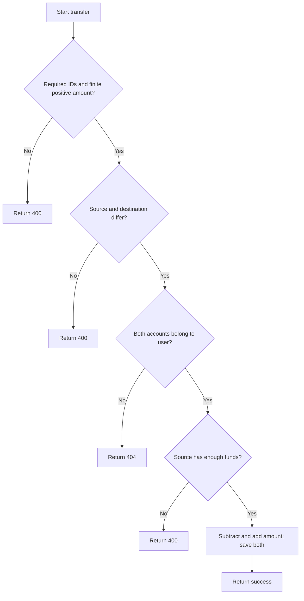

# Finora White-Box Analysis

## Core function

`transfer()` in `backend/controllers/accountController.js` is the selected critical path because it moves real account balances and has multiple rejection conditions.

## Simplified control-flow graph

## Cyclomatic complexity

At the simplified `if`-decision level, there are four decision nodes, so `V(G) = decisions + 1 = 5`. This count treats the compound required-input check as one decision and excludes the exception-handling edge; tooling that counts short-circuit subconditions may report a higher value. The corresponding five logical paths are: invalid input, same account, missing/foreign account, insufficient balance, and successful transfer.

## Coverage evidence

The latest Jest run reports 100% statements, 96.55% branches, 100% functions, and 100% lines for `accountController.js`. The remaining branch is an optional account update field path; transfer rejection and success paths are covered.

The full backend controller coverage report is generated by `npm run test:coverage`. Jest enforces minimum global thresholds of 90% statements, 85% branches, 95% functions, and 95% lines.

## Additional integrity checks

- Transactions are scoped by the authenticated user in list/detail/update/delete queries.
- Transaction creation verifies the selected account belongs to the authenticated user.
- Transaction updates now validate new values and check the destination account ownership before reversing the previous balance effect.
- Transfer amounts must be finite JavaScript numbers greater than zero; string amounts are rejected.
- Transfer tests assert that the combined account balance remains unchanged.
